# 🚀 FinCopilot — Персональный ИИ-Финансист (Telegram Mini App & iPhone Action Button)
> **Единый документ архитектуры, требований, модели данных и визуального стиля (PRD / System Spec)**  
> *Файл предназначен для использования в качестве контекста и технического задания при разработке в Google Antigravity IDE.*

---

## 1. 🎯 Общее видение и концепция продукта

### 1.1. Название и слоган
* **Рабочее название:** `FinCopilot TMA` (Telegram Mini App)
* **Суть продукта в одном предложении:** Персональный финансовый пульт управления внутри Telegram с встроенным ИИ-советником на базе Google Gemini API и мгновенным голосовым вводом расходов по нажатию физической кнопки **Action Button на iPhone**.

### 1.2. Проблемы, которые решает приложение
1. **Иллюзия «свободных денег»:** на карте видна одна сумма, но трудно удержать в голове, сколько из нее уйдет через 5–15 дней на кредиты, коммуналку или рассрочки. Итог — кассовый разрыв к концу месяца.
2. **Лень и трение ввода расходов:** классические приложения требуют разблокировать телефон, открыть апп, нажать «+», выбрать счет, категорию и дату. Это забрасывают через неделю. **Решение:** нажатие кнопки на корпусе iPhone $\to$ голос $\to$ Gemini всё сделает сам.
3. **Пассивность существующих трекеров:** они лишь констатируют факт («вы потратили 50 000 ₽»), но не предупреждают о рисках и не подсказывают стратегии: *«Как выгоднее погасить кредитку?»*, *«Сколько можно потратить в эти выходные без ущерба для обязательств?»*.
4. **Удобство платформы:** приложение живет прямо в Telegram (не нужно ставить отдельные тяжелые сборки из App Store, мгновенная синхронизация, push-уведомления от бота).

---

## 2. 🎙 Архитектура голосового ввода через iPhone Action Button

Ключевая инновация взаимодействия пользователя с системой: фиксация расхода занимает **менее 3 секунд**, без необходимости смотреть на экран и разблокировать телефон.

```mermaid
sequenceDiagram
    autonumber
    actor User as Пользователь (iPhone)
    participant AB as Кнопка Action Button
    participant SC as Быстрая команда (Apple Shortcut)
    participant API as FinCopilot API (/api/voice-expense)
    participant Gemini as Google Gemini 2.5 Flash
    participant DB as База Данных (Prisma ORM)
    participant Bot as Telegram Bot

    User->>AB: Зажатие физической кнопки Action Button
    AB->>SC: Запуск быстрой команды "FinCopilot Voice"
    SC->>User: Тактильный отклик (вибрация) + запись голоса (до 5 сек)
    User-->>SC: "Такси триста пятьдесят рублей от офиса"
    SC->>API: HTTP POST /api/voice-expense (Audio Blob + Bearer Token)
    
    rect rgb(20, 25, 45)
        Note over API,Gemini: Обработка нейросетью
        API->>Gemini: Передача аудиофайла + системный промпт
        Gemini-->>API: JSON: { amount: 350, category: "Транспорт", description: "Такси от офиса" }
    end

    API->>DB: Создание транзакции + списание со счета по умолчанию
    API->>API: Пересчет лимита Safe-to-Spend
    API->>Bot: Отправка квитанции в Telegram
    Bot-->>User: Push в Telegram: "✅ 350 ₽ — Транспорт. Остаток на день: 2 150 ₽"
```



### 2.1. Конфигурация Apple Shortcut (Быстрая команда iOS)
Быстрая команда настраивается один раз через приложение **«Команды» (Shortcuts)** на iOS:
1. **Действие 1: «Записать звук» (Record Audio)**
   * Источник: Встроенный микрофон.
   * Формат: M4A / AAC (минимальный вес файла для мгновенной отправки по сети).
   * Завершение записи: По касанию экрана или автоматически при паузе в речи.
2. **Действие 2: «Получить содержимое URL» (Get Contents of URL)**
   * Метод: `POST`
   * URL: `https://your-fincopilot-domain.com/api/voice-expense`
   * Заголовки:
     * `Authorization: Bearer <СЕКРЕТНЫЙ_API_КЛЮЧ_ПОЛЬЗОВАТЕЛЯ>`
   * Тело запроса: `Form / Multipart` с прикрепленным аудиофайлом (`audio/m4a`).
3. **Действие 3: «Вибрация» (Haptic Feedback)**
   * Тройной виброотклик об успешной отправке.

> **Альтернативный ультра-быстрый режим (Apple Dictation):**  
> Команда использует нативное действие iOS «Диктовать текст» (распознавание происходит на нейрочипе Apple Neural Engine без расхода трафика) и отправляет на сервер чистый текст: `{ "text": "Обед в столовой 480 рублей" }`.

---

## 3. 🤖 ИИ-Ассистент (Google Gemini API)

### 3.1. Мультимодальный разбор аудио (Audio-to-Transaction)
Gemini 2.5 Flash принимает входящий аудиофайл напрямую без сторонних провайдеров STT (Whisper и др.), что исключает ошибки двойной транскрипции и снижает время ответа до 400–700 мс.

#### Системный промпт для парсинга аудио / речи:
```text
Ты — финансовый парсер транзакций FinCopilot.
Твоя задача: прослушать аудиозапись (или прочитать распознанный текст) и извлечь структурированные финансовые параметры в строгом формате JSON.

ПРАВИЛА ИЗВЛЕЧЕНИЯ:
1. amount: Число (float/int). Если валюта не названа, по умолчанию считается RUB (рубли). Конвертируй слова ("полторы тысячи" -> 1500, "пятьсот рублей" -> 500).
2. category: Подбери наиболее подходящую категорию из списка:
   ["Продукты", "Кафе и рестораны", "Транспорт", "Жилье и ЖКХ", "Здоровье", "Развлечения", "Покупки", "Кредиты", "Связь", "Другое"].
3. description: Краткое очищенное описание траты (например: "Такси от офиса", "Кофе и круассан").
4. type: "EXPENSE" (по умолчанию) или "INCOME" (если сказано "получил зарплату", "перевели долг").
5. isDebtPayment: true, если пользователь явно упомянул гашение долга ("закинул на кредитку", "платеж по автокредиту").

ФОРМАТ ВЫВОДА (ТОЛЬКО ЧИСТЫЙ JSON):
{
  "amount": 1450.0,
  "category": "Транспорт",
  "description": "Такси до цеха",
  "type": "EXPENSE",
  "isDebtPayment": false,
  "confidence": 0.98
}
```

### 3.2. Расчет «Safe-to-Spend» (Безопасный лимит на день)
$$\text{Безопасный лимит в день} = \frac{\text{Текущий баланс} - \text{Резерв под обязательства до конца месяца} - \text{Целевая подушка}}{\text{Дней до конца расчетного периода}}$$

### 3.3. Финансовый аналитик (Чат в Telegram Mini App)
Внутри интерфейса Telegram Mini App доступно диалоговое окно с ассистентом:
* Ответ на вопросы в реальном времени: *«Могу ли я купить кроссовки за 9 000 ₽?»*.
* Сравнение стратегий закрытия кредитов («Лавина» по процентной ставке vs «Снежный ком» по сумме остатка).
* Рекомендации по оптимизации расходов при риске кассового разрыва.

---

## 4. 📱 Функциональные модули Telegram Mini App (TMA)

### 🔹 4.1. Аналитический Дашборд (Главный экран)
* **Интеграция с Telegram WebApp:** Полная поддержка темы оформления пользователя (Dark/Light sync), отключение вертикального свайпа на закрытие (`Telegram.WebApp.disableVerticalSwipes`), тактильный отклик через `Telegram.WebApp.HapticFeedback`.
* **Карточка 1: Реальный баланс** — суммарные остатки на всех привязанных счетах.
* **Карточка 2: Зарезервировано** — точная сумма, которая спишется по обязательствам до конца месяца.
* **Карточка 3: Safe-to-Spend** — крупный индикатор доступного лимита на сегодня (например: `2 150 ₽ / сегодня`) с цветовой шкалой риска (зеленый / желтый / красный).
* **Визуализация расходов:**
  * Интерактивная круговая диаграмма долей трат по категориям.
  * Лента недавних транзакций (с пометкой: «Добавлено голосом 🎙»).

### 🔹 4.2. Модуль кредитов и обязательств (Debt & Bills Hub)
* Карточки кредитов с прогресс-баром: выплачено vs остаток долга.
* Для кредитных карт: мониторинг беспроцентного грейс-периода (таймер дней до начисления процентов).
* Таймлайн предстоящих списаний на ближайшие 30 дней.
* Кнопка быстрой фиксации оплаты кредита в один клик.

### 🔹 4.3. Быстрый текстовый ввод
* Текстовая строка в верхней части дашборда для случаев, когда говорить голосом неудобно (на совещании/в транспорте).
* Тот же Gemini-парсер мгновенно разбирает введенный текст `750 ланч с коллегами`.

### 🔹 4.4. Настройки интеграции с iPhone
* Экран в Mini App со сгенерированным персональным API-токеном.
* Кнопка **«Установить Быструю команду на iPhone»** — прямая ссылка `https://www.icloud.com/shortcuts/...` для добавления готового сценария в 1 тап.
* Инструкция с картинкой: как назначить команду на физическую кнопку Action Button (Настройки $\to$ Кнопка действия $\to$ Быстрая команда $\to$ FinCopilot Voice).

---

## 5. 🎨 Дизайн и UI спецификация Telegram Mini App

### 5.1. Визуальный стиль
* **Дизайн-система:** Telegram Dark UI (глубокие графитовые оттенки, идеальное совпадение с нативным клиентом Telegram для iOS).
* **Палитра цветов:**
  * Background: `var(--tg-theme-bg-color, #0F172A)`
  * Card Surface: `#1E293B` с акцентным бордером `#334155`
  * Primary Text: `var(--tg-theme-text-color, #F8FAFC)`
  * Safe-to-Spend / Баланс в норме: Изумрудный `#10B981`
  * Обязательства / Предупреждения: Янтарный `#F59E0B`
  * Долги / Критический остаток: Розово-красный `#F43F5E`
  * Голос / ИИ Gemini: Индиго-фиолетовый градиент `#6366F1` $\to$ `#8B5CF6`
* **Шрифты:** Apple System Font (`-apple-system`, `SF Pro Display`, `SF Pro Text`) с моноширинными цифрами для аккуратного выравнивания балансов.

---

## 6. 🗄 Модель данных (Схема Prisma ORM)

```prisma
datasource db {
  provider = "sqlite" // Для облачного продакшена: "postgresql"
  url      = env("DATABASE_URL")
}

generator client {
  provider = "prisma-client-js"
}

// Профиль пользователя Telegram
model User {
  id              String        @id @default(cuid())
  telegramId      BigInt        @unique // ID пользователя в Telegram
  username        String?
  firstName       String?
  apiKey          String        @unique @default(cuid()) // Секретный токен для Apple Shortcut
  dailyBudgetMode String        @default("AUTO") // AUTO, STRICT, RELAXED
  createdAt       DateTime      @default(now())
  updatedAt       DateTime      @updatedAt

  accounts        Account[]
  categories      Category[]
  transactions    Transaction[]
  obligations     Obligation[]
  chatMessages    ChatMessage[]
}

// Счета пользователя
model Account {
  id           String        @id @default(cuid())
  userId       String
  user         User          @relation(fields: [userId], references: [id], onDelete: Cascade)
  name         String        // "Карта Т-Банк", "Наличные", "Кредитка Сбер"
  type         String        // DEBIT, CASH, SAVINGS, CREDIT
  balance      Float         @default(0.0)
  currency     String        @default("RUB")
  isDefault    Boolean       @default(false) // Счет для автоматических списаний голосом
  transactions Transaction[]
  createdAt    DateTime      @default(now())
  updatedAt    DateTime      @updatedAt
}

// Категории трат
model Category {
  id           String        @id @default(cuid())
  userId       String
  user         User          @relation(fields: [userId], references: [id], onDelete: Cascade)
  name         String        // "Продукты", "Транспорт", "Кафе"
  type         String        // EXPENSE, INCOME
  icon         String?       // "shopping-cart", "coffee", "car"
  color        String?       // HEX код цвета
  transactions Transaction[]
}

// Транзакции
model Transaction {
  id             String       @id @default(cuid())
  userId         String
  user           User         @relation(fields: [userId], references: [id], onDelete: Cascade)
  
  amount         Float
  type           String       // EXPENSE, INCOME, TRANSFER, DEBT_PAYMENT
  date           DateTime     @default(now())
  description    String?
  source         String       @default("MANUAL") // MANUAL, VOICE_ACTION_BUTTON, TELEGRAM_BOT
  
  accountId      String
  account        Account      @relation(fields: [accountId], references: [id], onDelete: Cascade)
  
  categoryId     String?
  category       Category?    @relation(fields: [categoryId], references: [id], onDelete: SetNull)
  
  obligationId   String?
  obligation     Obligation?  @relation(fields: [obligationId], references: [id], onDelete: SetNull)

  rawVoiceText   String?      // Исходный текст распознанной фразы для аудита
  createdAt      DateTime     @default(now())
}

// Кредиты и обязательства
model Obligation {
  id              String        @id @default(cuid())
  userId          String
  user            User          @relation(fields: [userId], references: [id], onDelete: Cascade)
  
  title           String        // "Ипотека", "Автокредит", "Рассрочка Яндекс"
  type            String        // CONSUMER_LOAN, CREDIT_CARD, INSTALLMENT, RECURRING_BILL
  totalAmount     Float?        // Начальное тело долга
  remainingAmount Float         // Текущий остаток долга
  interestRate    Float?        // Процентная ставка
  monthlyPayment  Float         // Сумма регулярного платежа
  dueDayOfMonth   Int           // День списания (1-31)
  gracePeriodEnd  DateTime?     // Для кредитных карт
  isCompleted     Boolean       @default(false)
  
  transactions    Transaction[]
  createdAt       DateTime      @default(now())
  updatedAt       DateTime      @updatedAt
}

// История диалогов с Gemini
model ChatMessage {
  id        String   @id @default(cuid())
  userId    String
  user      User     @relation(fields: [userId], references: [id], onDelete: Cascade)
  role      String   // "user" | "assistant"
  content   String
  createdAt DateTime @default(now())
}
```

---

## 7. 🛠 Технологический стек

* **Среда разработки:** Google Antigravity IDE
* **Платформа мини-приложения:** Telegram Mini Apps (TMA)
* **SDK Telegram:** `@telegram-apps/sdk-react` / `@twa-dev/sdk`
* **Фреймворк:** Next.js (App Router, Server Actions, API Routes, TypeScript)
* **Бот Telegram:** `grammY` (для отправки уведомлений и обработки команд)
* **ИИ и обработка речи:** `@google/genai` (модель `gemini-2.5-flash` для прямой обработки аудио и текста)
* **База данных и ORM:** Prisma ORM (SQLite для разработки / PostgreSQL для продакшена)
* **Стилизация и компоненты:** Tailwind CSS, shadcn/ui, Lucide React, Recharts
* **Клиент iOS:** Apple Shortcuts (Быстрые команды) + привязка к Action Button на iPhone 15 Pro / 16 / 16 Pro

---

## 8. 🏁 Пошаговый план реализации (Roadmap)

### Спринт 1: Фундамент Telegram Mini App и База Данных
- [ ] Инициализация проекта Next.js (App Router, TypeScript, Tailwind CSS).
- [ ] Настройка схемы Prisma ORM (модели `User`, `Account`, `Transaction`, `Obligation`, `Category`).
- [ ] Настройка Telegram WebApp SDK (авторизация по `initData`, темная тема, haptics).

### Спринт 2: Интеграция с iPhone Action Button и Gemini Voice API
- [ ] Создание API-эндпоинта `POST /api/voice-expense` с проверкой Bearer-токена.
- [ ] Подключение `@google/genai` с мультимодальной обработкой аудиозаписи.
- [ ] Логика авто-создания транзакции и пересчета баланса.
- [ ] Отправка мгновенного отчета через Telegram-бота в чат пользователя.
- [ ] Создание шаблона Быстрой команды Apple Shortcut для экспорта на iPhone.

### Спринт 3: Дашборд Safe-to-Spend и модуль аналитики
- [ ] Реализация карточек: «Баланс», «Зарезервировано», «Safe-to-Spend на день».
- [ ] Круговая диаграмма категорий трат (Recharts).
- [ ] Лента транзакций с подсветкой голосовых записей.

### Спринт 4: Модуль кредитов и обязательств
- [ ] Экраны добавления кредитов, кредитных карт и ежемесячных счетов.
- [ ] Календарь дедлайнов списаний на 30 дней.
- [ ] Кнопка фиксации погашения обязательства в 1 клик.

### Спринт 5: ИИ-советник и сценарии бюджета
- [ ] Чат-интерфейс в Mini App с Gemini-консультантом.
- [ ] Анализ сценариев «Лавина» vs «Снежный ком».
- [ ] Кнопки быстрых промптов (*«Сколько можно потратить на выходных?»*).
